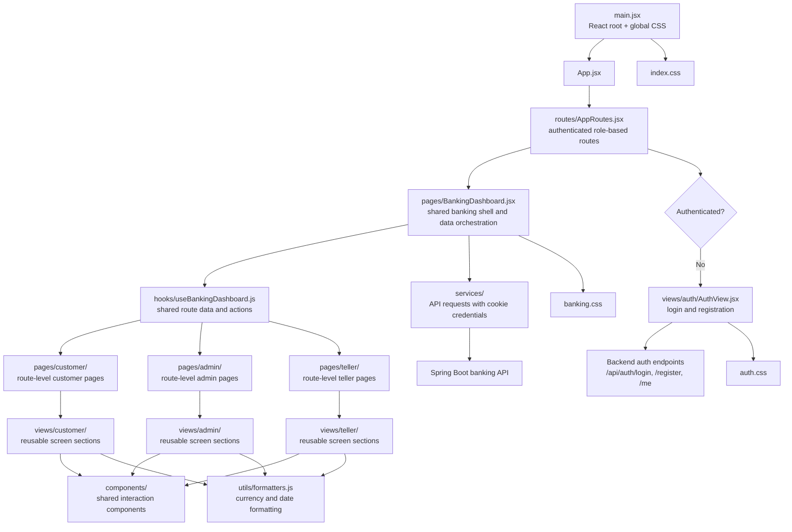

# Frontend Architecture

## Module Responsibilities

- `main.jsx` mounts the React application and global stylesheet.
- `App.jsx` delegates to the route tree.
- `routes/AppRoutes.jsx` declares role-specific routes; `routes/RoleRoute.jsx` restricts each route group to its intended role.
- `pages/BankingDashboard.jsx` owns the shared banking shell, cross-page data orchestration, and modal state.
- `hooks/useBankingDashboard.js` exposes shared data and actions through React Router outlet context.
- `pages/customer/`, `pages/admin/`, and `pages/teller/` contain one route-level page per banking workflow. These pages compose reusable sections from `views/`.
- `controllers/` owns workflow behavior; `services/` owns backend communication; `utils/formatters.js` centralizes presentation formatting.

Page navigation is URL-based under `/app/customer/*`, `/app/admin/*`, and `/app/teller/*`, so browser history, refreshes, and deep links preserve the active screen.
