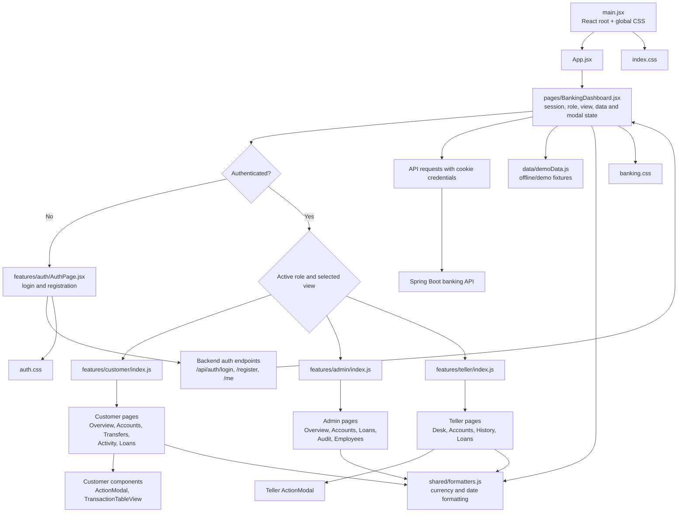

# Frontend Architecture

## Module Responsibilities

- `main.jsx` mounts the React application and global stylesheet.
- `App.jsx` selects the top-level dashboard page.
- `pages/BankingDashboard.jsx` owns authentication state, role selection, current view, API orchestration, and modal state.
- `features/auth/` contains the sign-in and registration page.
- `features/customer/`, `features/admin/`, and `features/teller/` contain role-specific pages, reusable components, and barrel exports.
- `data/demoData.js` supplies demo fixtures; `shared/formatters.js` centralizes currency and date formatters.

Navigation is currently controlled by the dashboard's `view` state; page selections do not change the browser URL.
